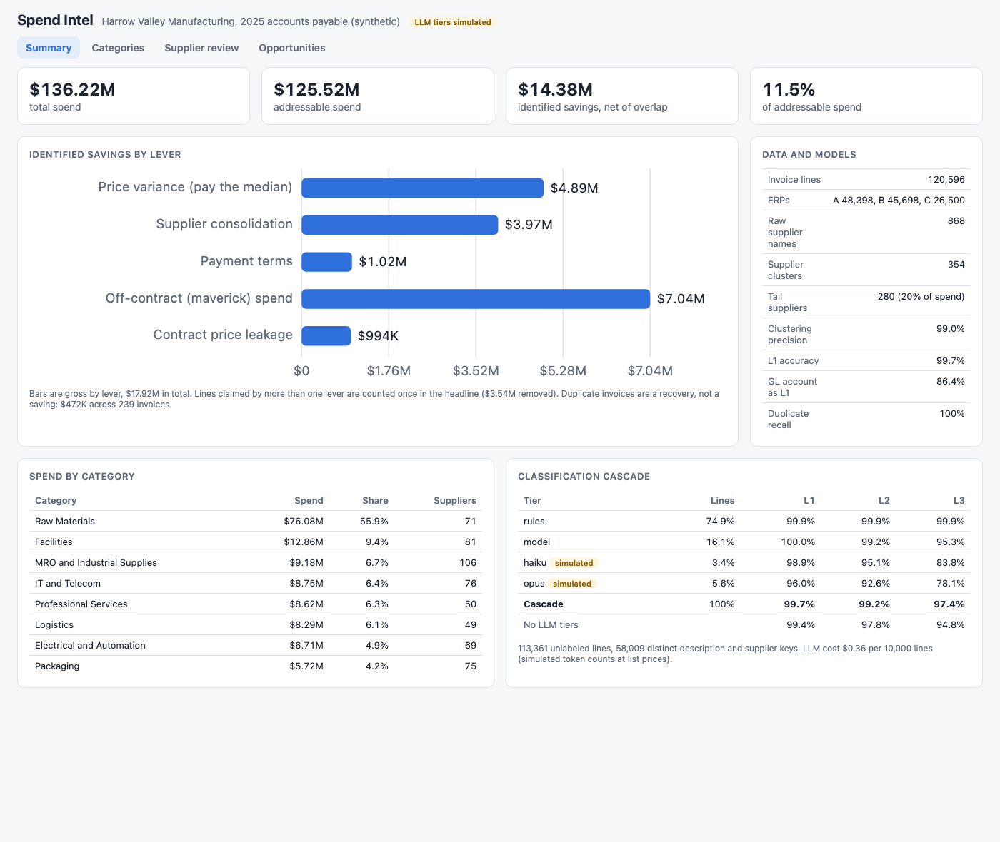

# Spend Intel

Procurement spend analytics for Harrow Valley Manufacturing, a made-up mid-size manufacturer. It takes a year of messy accounts payable data from three ERPs (120,596 invoice lines, 868 spellings of 331 suppliers), resolves suppliers into parent companies, classifies every line into a 3-level category tree with a rules, model, and LLM cascade, builds a spend cube, and finds savings with the invoice lines behind each one. All data is synthetic and seeded, and the Claude tiers are **simulated** by default (no API calls), so every number below reproduces with `make analyze`.



| Savings lever | Opportunities | Estimated annual value |
|---|---|---|
| Off-contract (maverick) spend | 59 | $7.04M |
| Price variance (pay the median) | 765 | $4.89M |
| Supplier consolidation (6% on spend moved to top 3) | 42 | $3.97M |
| Payment terms (missed discounts, short terms, early payment) | 294 | $1.02M |
| Contract price leakage | 25 | $0.99M |
| **Total, net of overlap** | | **$14.38M (11.5% of $125.5M addressable)** |
| Duplicate invoices (recovery, not savings) | 239 | $0.47M |

Gross by lever is $17.92M. Price variance, maverick, and leakage can claim the same line, so the headline takes the largest of the three per line and removes $3.54M of double counting.

## Why

The first deliverable of almost every procurement engagement is a spend cube: who do we buy from, what do we buy, and where is the money leaking. It is hard because AP data was never meant for analysis. The same supplier is keyed as "ACME Industrial Supply", "Acme Ind. Supply Co", and "ACME INDUSTRIAL SUPPLY LLC". Line text says "SS bolt M8x30 qty 500" or "PN 44120-B per PO". GL accounts depend on which clerk booked the invoice: here the GL account predicts the right top-level category only 86.4% of the time. This repo works through the parts that make or break the deliverable: supplier resolution with measured precision, classification that is cheap where it can be and careful where it must be, savings levers that show their evidence, and a review loop for the cases a machine should not decide alone.

## Architecture

```
ERP A (YYYYMMDD, NT30, 610200)  ┐
ERP B (MM/DD/YYYY, cents, Net 30) ├─▶ ingest: one schema, terms parsed, unit price derived where missing
ERP C (DD.MM.YYYY, "1,234.50")  ┘
        │
        ├─▶ suppliers: clean ─▶ block ─▶ score (IDF token Jaccard + char trigrams) ─▶ union-find
        │                      ≥ 0.80 merge, 0.62 to 0.80 review queue (UI + API, decisions logged)
        │
        ├─▶ classify (per distinct description + supplier):
        │     1 keyword rules ── conf ≥ 0.90 ──▶ done
        │     2 TF-IDF char n-grams + supplier tokens, logistic regression ── p ≥ 0.70 ──▶ done
        │     3 Claude Haiku 5.5, 20 lines per call, JSON schema output ── conf ≥ 0.85 ──▶ done
        │     4 Claude Opus 5.5 (server-side refusal fallback) ──▶ done
        │
        ├─▶ cube: category x supplier x business unit x month; HHI, tail spend, addressable spend
        ├─▶ contracts: match lines to contracted items by alias similarity within the category
        └─▶ levers: price variance, consolidation, payment terms, maverick, leakage, duplicates
                    each with value and evidence lines ─▶ FastAPI ─▶ web UI, /metrics, JSON logs
```

| Piece | File |
|---|---|
| 8 L1, 22 L2, 45 L3 categories written for this demo, with items and invoice phrasings | `src/spendintel/taxonomy.py` |
| Seeded generator: 3 ERP formats, name variants, typos, GL noise, contracts, duplicates, legitimate repeat invoices | `src/spendintel/generator.py` |
| ERP adapters and payment terms parser | `src/spendintel/ingest.py` |
| Name cleaning, blocking, scoring, clustering, pairwise precision and recall, review book | `src/spendintel/suppliers.py` |
| Rules, model tier, cascade, accuracy per level, tier report | `src/spendintel/classify.py` |
| Claude classifier and brief writer, simulated tiers, grounding check | `src/spendintel/llm.py` |
| Cube queries, HHI, tail spend | `src/spendintel/cube.py` |
| Savings levers, contract matching, duplicate detection | `src/spendintel/opportunities.py` |
| Contract price compliance and leakage | `src/spendintel/compliance.py` |
| Pipeline, evaluation, CI gate | `src/spendintel/pipeline.py`, `cli.py` |
| API, metrics, logs, UI | `src/spendintel/app.py`, `metrics.py`, `logs.py`, `static/index.html` |

## Results

All numbers are from the default run: 120,596 lines, seed 42, 6% of lines labeled by an "analyst" for training. Accuracy is measured on the other 113,361 lines.

**Supplier resolution.** 868 raw names become 354 clusters (331 true parents). Pairwise precision 99.0%, recall 93.3%. Blocking compares 5,829 of 93,096 possible pairs. The 89 review items are ordered by spend, so the biggest dollars get a human look first. The misses are mostly truncated names like "Cedar Metal Ltd" for "Cedar Metal Service Center", which land in the review queue rather than being merged. False merges are rarer because rare words (the company's own name) carry more weight than "supply" or "industrial".

**Classification.**

| Tier | Share of lines | L1 | L2 | L3 |
|---|---|---|---|---|
| Keyword rules | 74.9% | 99.9% | 99.9% | 99.9% |
| TF-IDF model | 16.1% | 100.0% | 99.2% | 95.3% |
| Haiku (simulated) | 3.4% | 98.9% | 95.1% | 83.8% |
| Opus (simulated) | 5.6% | 96.0% | 92.6% | 78.1% |
| **Cascade** | 100% | **99.7%** | **99.2%** | **97.4%** |
| Without LLM tiers | 100% | 99.4% | 97.8% | 94.8% |
| GL account alone | 100% | 86.4% | | |

LLM cost is $0.36 per 10,000 lines at list prices (Haiku 5.5 $0.10/$0.50, Opus 5.5 $4/$20 per million tokens), from 397 Haiku and 251 Opus calls. Lines are deduplicated by description and supplier before classification (58,009 keys for 113,361 lines). The LLM tiers get the hardest 9% of lines, which is why their accuracy looks lower than the rules: they see "item 44120" and "monthly charges". Their accuracy is a configured assumption, not a measurement. Treat the cascade gain over no-LLM (+2.6 points at L3) as a hypothesis to confirm with a real run.

**Other evaluations.** Item grouping for price variance: 100% purity on 89% of lines (the rest are too terse to group safely). Contract item matching: 99.0% precision, 84.3% recall. Duplicate invoices: 239 found, precision and recall both 100% on the synthetic set, including 119 legitimate repeat invoices (same amount, next invoice number, days apart) that a naive matcher would flag. Contract price compliance: 66.6% of lines billed by the contracted supplier match the contract price; leakage is $1.02M.

More views: [opportunities with evidence (dark mode)](docs/opportunities.png), [supplier review queue](docs/suppliers.png), [category drill-down](docs/categories.png).

## How to run

```bash
cd spend-intel
uv sync --python 3.12
make test                 # 85 tests, about 10 seconds
make analyze              # full pipeline on 120,000 lines, prints the lever table, writes data/report.json (about 90 s)
make run                  # API and UI on http://127.0.0.1:8849 (builds the cube at startup, about 90 s)
SPENDINTEL_LINES=20000 make run   # faster startup on a smaller dataset
```

Optional Claude provider for category briefs (offline template by default):

```bash
uv sync --python 3.12 --extra claude
export ANTHROPIC_API_KEY=...       # never commit it; see .env.example
SPENDINTEL_LLM=claude make run
```

The brief writer gets only computed facts as JSON. Every number in Claude's reply is checked against those facts; if any number cannot be traced, the API returns the offline template and says why.

API highlights: `/api/summary`, `/api/cube?group_by=l2,bu&l1=MR`, `/api/categories?level=l3&parent=MR-FAS`, `/api/categories/{code}/brief`, `/api/suppliers/clusters`, `/api/suppliers/review` and `POST /api/suppliers/review/{id}` with `{"action": "merge" | "reject" | "confirm" | "split", "name": ...}`, `/api/classification?max_confidence=0.8`, `/api/opportunities?lever=maverick`, `/api/opportunities/{id}` (with evidence), `/api/duplicates`, `/api/compliance`, `/healthz`, `/metrics`.

Docker is not needed locally. The `Dockerfile` (multi-stage, non-root user, HEALTHCHECK) is built and smoke tested in CI.

## Tests

85 tests (`make test`), about 10 seconds:
- name cleaning, typo-tolerant token matching, IDF weighting, clustering on hand-built variants and hard negatives, blocking, pairwise precision and recall by hand, review merge and split
- rule classifier hits and ambiguity, model tier on a 9-line training set, cascade routing (rules, model, Haiku, Opus, LLM off), accuracy per taxonomy level and spend-weighted
- HHI and tail spend by hand, cube queries and category profiles
- price variance savings on a hand-worked example, outlier handling, payment terms math (missed discount, short terms, paid early), contract matching, maverick detection, leakage with tolerance, invoice number normalization, duplicate detection
- ERP parsing and seeded generation, structured output validation, Claude request shape against a fake client (including Opus fallback and refusals), brief grounding
- API end to end on a 6,000 line run, plus the quality gate

CI (`.github/workflows/ci.yml`) runs ruff, the tests, a quality gate that runs the pipeline on 40,000 lines and fails if supplier clustering precision or L1 accuracy drops below 97%, and a Docker build with a container smoke test.

## Production notes

- Supplier resolution would add tax IDs, remit-to addresses, and bank details as blocking keys, and a corporate hierarchy feed for subsidiaries that share no words with the parent ("Calder Holdings" owning "Brightline Freight"). Review decisions would be stored and replayed on every monthly refresh.
- The real LLM tiers need a measured eval before the thresholds mean anything: label a few thousand lines, run Haiku and Opus on them, and set thresholds from the cost and accuracy curve. Use the Batch API (half price) for the monthly backfill and prompt caching for the taxonomy prompt.
- At tens of millions of lines the cube moves to a warehouse (DuckDB or Snowflake) with incremental loads per ERP, and classification runs only on new distinct keys, which is a small fraction each month.
- Savings rates (6% for consolidation, 8% cost of capital, 60 day terms policy) are config, and a finance partner should sign them off. Category managers validate each opportunity before it counts toward a target.
- Item matching would use the item master and supplier part numbers where they exist. Description matching is the fallback for spot buys.
- Access control by business unit and an audit log for review decisions, since cluster merges change who gets credit for spend.

## License

MIT. See [LICENSE](LICENSE).
